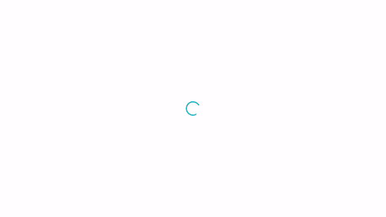
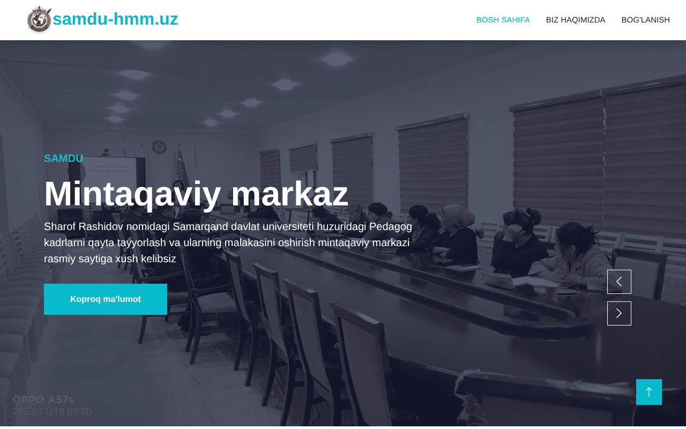
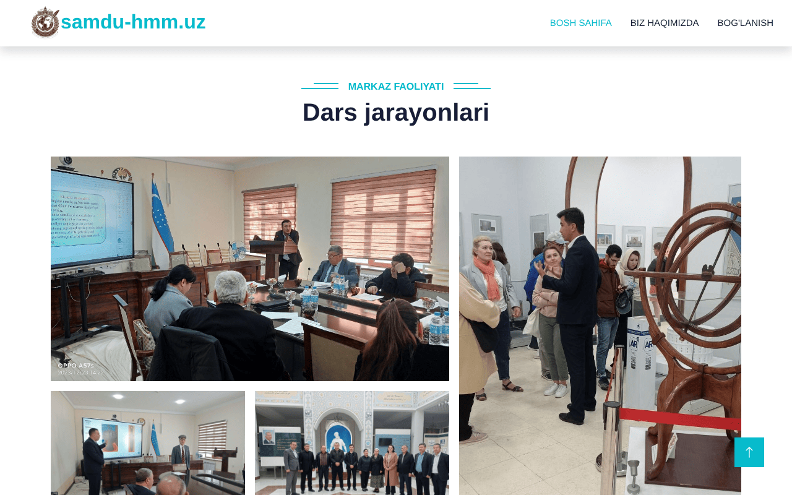
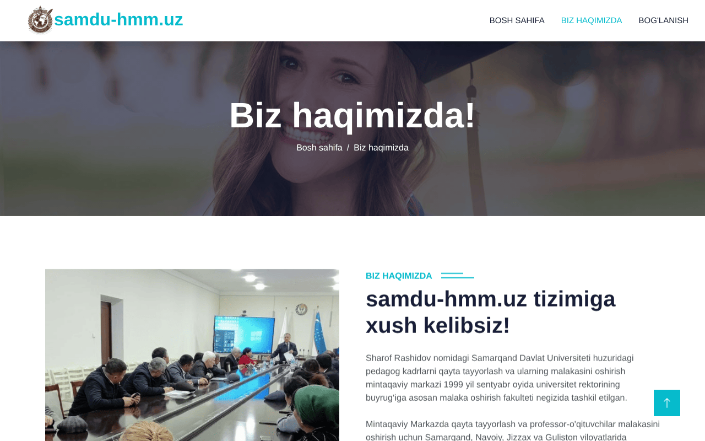
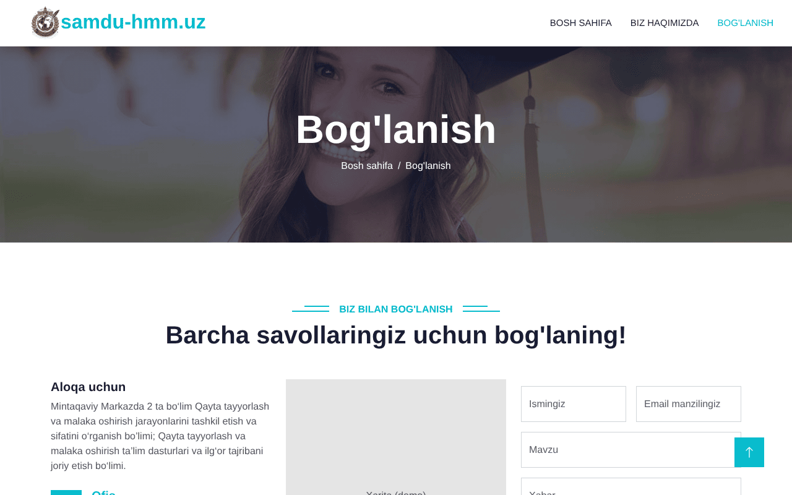
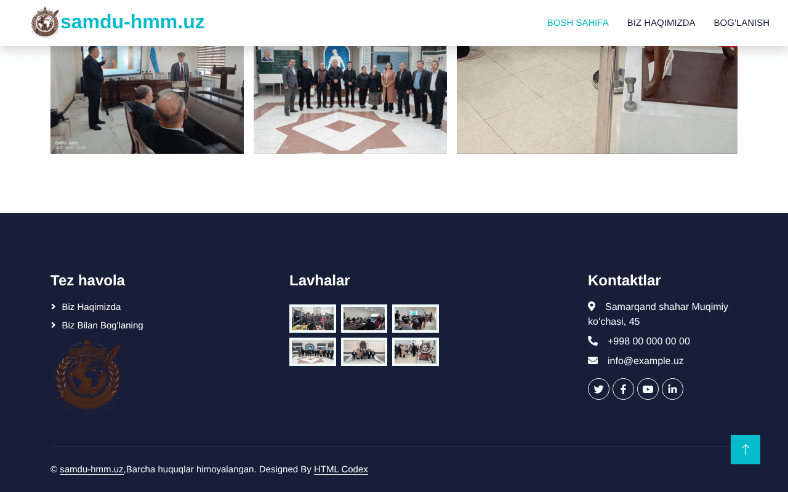
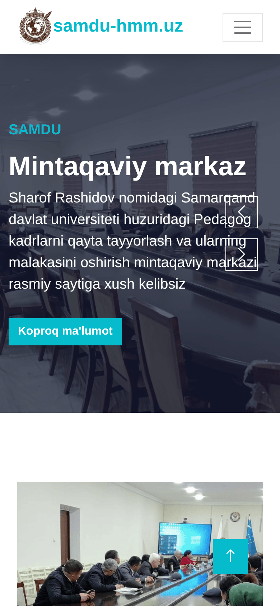
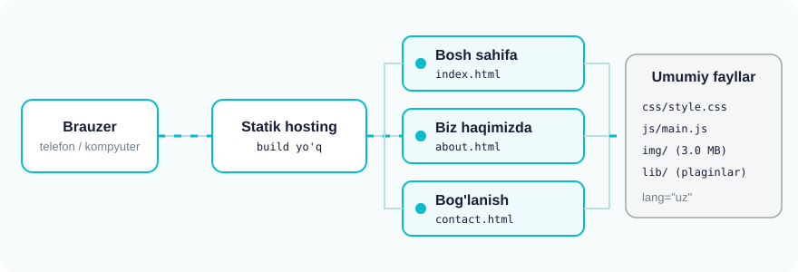

<div align="center">

# Mintaqaviy markaz — sayt

Samarqand davlat universiteti huzuridagi Pedagog kadrlarni qayta tayyorlash va malaka oshirish mintaqaviy markazining o'zbekcha statik sayti.


[Ko'rinish](#korinish) ·
[Qanday ishlaydi](#qanday-ishlaydi) ·
[Ishga tushirish](#ishga-tushirish) ·
[Cheklovlar](#xavfsizlik-va-cheklovlar) ·
[Optimizatsiya](#optimizatsiya-oldin-va-keyin)



</div>

> [!NOTE]
> Screenshot va GIF'larda telefon va e-pochta demo qiymatlarga (`+998 00 000 00 00`, `info@example.uz`) almashtirilgan. Xarita o'rnida "Xarita (demo)" plashkasi turibdi. Suratlar va matnlar saytning asl kontenti.

## Ko'rinish

| Bosh sahifa | Dars jarayonlari |
|---|---|
|  |  |
| **Biz haqimizda** | **Bog'lanish** |
|  |  |

<details>
<summary>Footer va telefondagi ko'rinish</summary>





</details>

## Qanday ishlaydi



- Server tomoni yo'q. Uchta o'zbekcha sahifa bor: `index.html`, `about.html` va `contact.html`.
- Barcha yo'llar nisbiy, shuning uchun sayt istalgan statik hostingda va ichki yo'lda ishlaydi.
- `courses.html`, `team.html`, `testimonial.html` va `404.html` shablondan qolgan. Menyuda ular izohga olingan.

## Ishga tushirish

Build kerak emas:

```bash
git clone https://github.com/AbduazizBobomalikovNode/Mintaqaviy-markaz-static.git
cd Mintaqaviy-markaz-static
python3 -m http.server 8000
```

Keyin `http://localhost:8000` ni oching. Muhit o'zgaruvchilari yo'q. Ikonka, shrift, jQuery va Bootstrap JS CDN'dan yuklanadi.

## Xavfsizlik va cheklovlar

- **Forma hech narsa yubormaydi.** `contact.html` dagi `<form>` da `action` ham, ishlov beruvchi ham yo'q.
- **Bo'sh havolalar.** Ijtimoiy tarmoq ikonkalari, bosh sahifadagi to'rtta kategoriya rasmi va copyright havolasi `href=""` yoki `#`.
- **Telefon raqamida xato bo'lishi mumkin.** Saytdagi raqam `+988` bilan boshlanadi, O'zbekiston kodi esa `+998`. Matn o'zgartirilmadi.
- **Shablon qoldiqlari.** Biz haqimizda va bog'lanish sahifalari sarlavhasida shablonning stok surati (`img/carousel-1.jpg`) turibdi. Shablon xatosi tufayli sahifa tepasida "yuqoriga" tugmasi ko'rinib turadi. Telefonda karusel strelkalari matnni qoplaydi.
- **Tashqi resurslar.** jQuery (code.jquery.com), Bootstrap JS va Bootstrap Icons (jsdelivr), Font Awesome (cdnjs), Google Fonts va Google Maps ulanadi. SRI (`integrity`) yo'q.
- `meta description` va `keywords` bo'sh.

## Optimizatsiya: oldin va keyin

| Ko'rsatkich | Oldin | Keyin |
|---|---|---|
| `img/` hajmi | 5.8 MB | **3.0 MB** |
| `logo.png` | 365 KB, 476×524 | **33 KB**, 240×264 |
| Favicon (`trans_bg.png`) | 590 KB, 1230×1405 | **25 KB**, 224×256 |
| Footer lavhalari | 170–200 KB, 1366×768 | **21–30 KB**, 480×270 |
| Yo'q faylga havolalar | 4 (`img/favicon.ico`) | **0** |
| `lang="uz"` | 0 sahifa | **3 sahifa** |
| HTML Codex krediti | 4 / 7 sahifa | **7 / 7** |
| Rasmlarga `alt` | asosan bo'sh | **36 ta**, o'zbekcha |
| Klaviatura fokusi | ko'rinmaydi | `:focus-visible` |
| `prefers-reduced-motion` | yo'q | CSS va JS: WOW, karusel va skroll animatsiyasi o'chadi |

Boshqa o'zgarishlar:
- Navbar tugmasi, ijtimoiy ikonkalar, "yuqoriga" tugmasi va karusel strelkalariga o'zbekcha `aria-label` qo'yildi. Faol menyu bandiga `aria-current` qo'shildi.
- 27 ta rasmga `loading="lazy"` berildi.
- Bootstrap 5'da ishlamaydigan `sr-only` klassi `visually-hidden` ga almashtirildi.
- Footer'dagi bo'sh "Biz haqimizda" va "Bog'lanish" havolalari ulandi.

## Loyiha tuzilishi

```
index.html, about.html, contact.html   o'zbekcha sahifalar
courses.html, team.html,               shablondan qolgan sahifalar (menyuda yo'q)
testimonial.html, 404.html
css/style.css                          uslublar (+ a11y bloki oxirida)
js/main.js                             spinner, WOW, karusel, "yuqoriga" tugmasi
img/ishxona/                           markaz suratlari va logotip
lib/                                   animate, easing, owlcarousel, waypoints, wow
scss/                                  Bootstrap SCSS manbasi (ishlatilmaydi)
docs/media/                            README rasmlari
NOTICE                                 shablon krediti va o'zgarishlar ro'yxati
```

## Litsenziya

Sayt HTML Codex'ning [eLEARNING](https://htmlcodex.com/elearning-html-template) shabloni asosida qilingan. Shablon **CC BY 4.0** litsenziyasida, shuning uchun har bir sahifada "Designed By HTML Codex" krediti saqlangan. Batafsil: `LICENSE.txt`, `READ-ME.txt`, `NOTICE`.

Suratlar, logotip va matnlar markazga tegishli.

## Muallif

**Bobomalikov Abduaziz** · GitHub [@AbduazizBobomalikovNode](https://github.com/AbduazizBobomalikovNode) · tashkilot [abdusoft-uz](https://github.com/abdusoft-uz)
